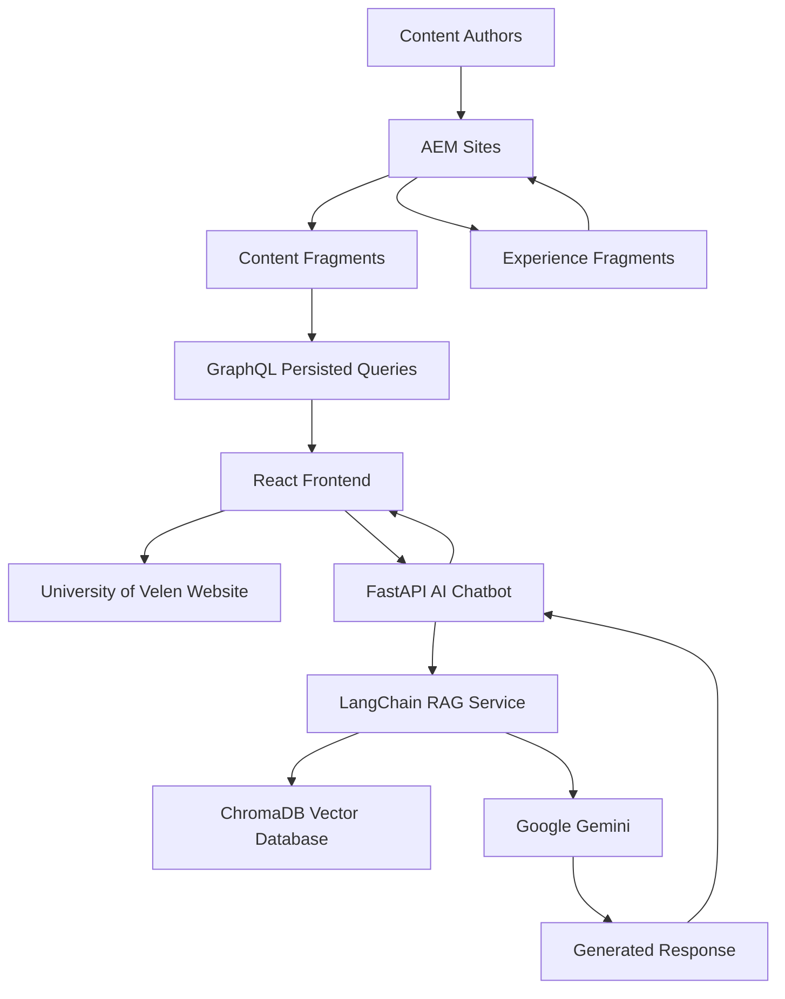
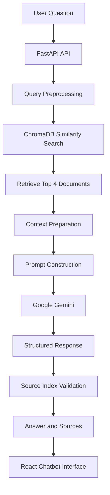

# University of Velen – University Digital Campus Portal (UDCP)

A modern university website developed using **Adobe Experience Manager (AEM) Sites, AEM Headless GraphQL, React, and AI-powered technologies**.

The University of Velen project demonstrates the integration of enterprise content management, modern frontend development, headless architecture, and Retrieval-Augmented Generation (RAG) to create a dynamic and intelligent university digital experience.

The solution combines AEM Sites for content management, GraphQL for structured content delivery, React for the user interface, and a FastAPI-based AI chatbot for conversational university assistance.

---

## Table of Contents

- [Project Overview](#project-overview)
- [Key Features](#key-features)
- [Project Architecture](#project-architecture)
- [Technology Stack](#technology-stack)
- [AEM Sites Implementation](#aem-sites-implementation)
- [React Headless Frontend](#react-headless-frontend)
- [AI-Powered RAG Chatbot](#ai-powered-rag-chatbot)
- [Project Structure](#project-structure)
- [Prerequisites](#prerequisites)
- [Installation and Setup](#installation-and-setup)
- [Running the Application](#running-the-application)
- [API Endpoints](#api-endpoints)
- [Testing and Validation](#testing-and-validation)
- [Security and Configuration](#security-and-configuration)
- [Future Enhancements](#future-enhancements)
- [Project Summary](#project-summary)
- [Author](#author)

---

## Project Overview

University of Velen is a university website developed as part of the University Digital Campus Portal (UDCP) capstone project.

The project demonstrates how enterprise content management and modern web technologies can work together to deliver a scalable and maintainable digital experience.

It combines three major components:

1. **AEM Sites:** Manages university content through reusable components, editable templates, Content Fragments, and Experience Fragments.
2. **React Headless Frontend:** Consumes structured university content from AEM through GraphQL persisted queries and dynamically renders it.
3. **AI-Powered Chatbot:** Uses Retrieval-Augmented Generation to answer university-related questions using retrieved knowledge and Google Gemini.

The project focuses on reusable architecture, structured content management, responsive user experiences, reliable data handling, and AI-powered information access.

## Key Features

### AEM Sites

- Reusable AEM components.
- Editable templates and content policies.
- Experience Fragments for shared website sections.
- Content Fragments for structured university information.
- Sling Models, OSGi services, and HTL.
- Client Libraries and Core Components.
- GraphQL persisted queries for headless content delivery.

### React Headless Frontend

- Modern university homepage.
- Dynamic course, faculty, and event sections.
- School-based course filtering.
- AEM Headless GraphQL integration.
- Reusable React components.
- Loading, error, retry, and empty states.
- Safe handling of missing images, links, and optional fields.
- Responsive user interface.

### AI-Powered RAG Chatbot

- FastAPI-based chatbot backend.
- LangChain integration.
- Google Gemini 3.1 Flash-Lite.
- ChromaDB vector database.
- Similarity-based document retrieval.
- Context-grounded answer generation.
- Structured response validation.
- Supporting source information.
- Fallback handling for unsupported questions.

---

## Project Architecture

The application follows a headless architecture in which AEM manages structured content, React consumes content through GraphQL, and a separate AI backend provides conversational assistance.

### Overall Architecture



### Architecture Responsibilities

| Component | Responsibility |
|---|---|
| AEM Sites | Content authoring and management. |
| Content Fragments | Structured university information. |
| Experience Fragments | Reusable website sections such as header and footer. |
| GraphQL | Headless content delivery. |
| React | Dynamic website rendering and user interaction. |
| FastAPI | AI chatbot API and request handling. |
| LangChain | Retrieval and LLM orchestration. |
| ChromaDB | Vector storage and similarity search. |
| Google Gemini | Context-based response generation. |

---

## Technology Stack

| Category | Technologies |
|---|---|
| CMS | Adobe Experience Manager (AEM) Sites |
| AEM Backend | Java, Sling Models, OSGi, HTL |
| AEM Frontend | Client Libraries, HTML, CSS, JavaScript |
| Content Management | Content Fragments, Experience Fragments |
| Content Delivery | AEM Headless, GraphQL |
| Frontend Framework | React 19 |
| Frontend Tooling | Vite 8, npm |
| Frontend Language | JavaScript |
| Styling | CSS3 |
| AI Backend | Python 3.14+, FastAPI |
| AI Orchestration | LangChain |
| Language Model | Google Gemini 3.1 Flash-Lite |
| Vector Database | ChromaDB |
| Embeddings | LangChain Google GenAI integration |
| Response Validation | Pydantic |
| Python Dependency Management | uv |
| Build Tools | Maven, npm |
| Version Control | Git, GitHub |
| Development Tools | Visual Studio Code |

---

## AEM Sites Implementation

Adobe Experience Manager provides the content management foundation for the University of Velen website.

### 1. Reusable Components

The AEM implementation includes reusable components for:

- Hero Banner
- Course Highlights
- Faculty Profiles
- Upcoming Events

These components allow authors to manage and present university information through reusable content structures.

### 2. Editable Templates

Editable templates provide a consistent page structure and allow authors to create and manage pages using configured components and content policies.

### 3. Experience Fragments

Experience Fragments provide reusable website sections.

The project uses them for:

- Header
- Footer

This helps maintain consistent shared content across the website.

### 4. Content Fragments

Content Fragments maintain structured university information independently of page presentation.

The project uses structured content for:

- Academic Courses
- Faculty Profiles
- University Events

### 5. AEM Backend Development

The AEM implementation uses:

- Sling Models
- OSGi Services
- HTL
- Client Libraries
- Core Components

These technologies support component development, backend logic, and website presentation.

### 6. AEM Headless GraphQL Integration

AEM GraphQL exposes structured Content Fragment data to the React frontend.

The project uses the following persisted queries:

| Persisted Query | Purpose |
|---|---|
| `udcp/all-courses` | Retrieves university course information. |
| `udcp/all-faculty` | Retrieves faculty profiles. |
| `udcp/all-events` | Retrieves upcoming university events. |

The React application consumes these queries through its GraphQL service layer.

---

## React Headless Frontend

The React application provides the user-facing University of Velen website.

It retrieves structured content from AEM using Headless GraphQL and dynamically renders the information through reusable React components.

### Main Features

- University homepage with hero section.
- University highlights and admissions information.
- Dynamic course listings.
- School-based course filtering.
- Faculty profile display.
- Upcoming events display.
- Reusable UI components.
- AI chatbot integration.
- Responsive website layout.
- Dedicated registration page.

### Component Architecture

The frontend follows a reusable component-based structure.

| Component | Responsibility |
|---|---|
| `Header.jsx` | University navigation and header. |
| `HeroSection.jsx` | Homepage hero section. |
| `HighlightsSection.jsx` | University highlights. |
| `AdmissionsSection.jsx` | Admissions information. |
| `CourseSection.jsx` | Course listing. |
| `CourseCard.jsx` | Individual course display. |
| `CourseFilter.jsx` | School-based course filtering. |
| `FacultySection.jsx` | Faculty listing. |
| `FacultyCard.jsx` | Individual faculty display. |
| `EventsSection.jsx` | Upcoming events. |
| `EventCard.jsx` | Individual event display. |
| `AIChatbot.jsx` | Chatbot interface. |
| `SiteFooter.jsx` | Website footer. |
| `RegistrationPage.jsx` | Registration interface. |

### GraphQL Integration

The frontend separates GraphQL communication from presentation components.

Important files:

- `services/aemGraphql.js` – AEM GraphQL communication.
- `hooks/useAemCollection.js` – Collection data and state management.
- `utils/contentFormatters.js` – Content formatting and safe data handling.

### Error and Data Handling

The application handles different content and API scenarios:

- Loading states while retrieving content.
- API and GraphQL errors.
- Retry functionality where implemented.
- Empty collections.
- Missing images.
- Missing links.
- Optional fields.
- Incomplete content.

These safeguards help prevent missing or incomplete CMS content from breaking the user interface.

---

## AI-Powered RAG Chatbot

The project includes a separate FastAPI-based AI chatbot designed to answer questions about the University of Velen.

It uses Retrieval-Augmented Generation to retrieve relevant university information before generating responses.

### Technology

- Python
- FastAPI
- LangChain
- Google Gemini 3.1 Flash-Lite
- ChromaDB
- LangChain Chroma
- LangChain Google GenAI
- Pydantic
- Uvicorn

### RAG Architecture



### RAG Workflow

1. **User Query:** Receives a university-related question through the React chatbot.
2. **FastAPI Request:** Processes the question through the `/api/chat` endpoint.
3. **Query Preprocessing:** Recognizes greetings and chatbot identity questions without invoking the LLM.
4. **Document Retrieval:** Performs similarity search against ChromaDB and retrieves the top four relevant documents.
5. **Context Preparation:** Combines retrieved document content and metadata.
6. **Prompt Construction:** Builds a university-specific prompt with instructions to avoid unsupported answers.
7. **Response Generation:** Uses Google Gemini 3.1 Flash-Lite to generate a structured response.
8. **Response Validation:** Uses Pydantic output parsing to validate the generated response.
9. **Source Validation:** Validates source document indices and extracts supporting metadata.
10. **Response Delivery:** Returns the generated answer and source information to the React frontend.

### Key RAG Capabilities

- Context-grounded university answers.
- Similarity-based document retrieval.
- Structured LLM output validation.
- Supporting source information.
- Fallback responses for unsupported questions.
- Greeting and identity recognition.
- Cached vector-store and Gemini clients using `lru_cache`.
- Error handling during response generation.

### Example Chat Request

**Endpoint:** `POST /api/chat`

```json
{
  "question": "What courses are offered by the University of Velen?"
}
```

### Example Response

```json
{
  "answer": "The answer based on the university knowledge base.",
  "sources": [
    {
      "type": "course",
      "title": "Course Information",
      "path": "/content/example"
    }
  ]
}
```

The actual answer and source metadata depend on the retrieved university documents.

---

## Project Structure

The repository contains three primary application areas: AEM Sites, React frontend, and the AI chatbot.

```text
udcp/
│
├── core/
│
├── it.tests/
│
├── ui.apps/
│
├── ui.config/
│
├── ui.content/
│
├── ui.tests/
│
├── all/
│
├── analyse/
│
├── react-frontend/
│   ├── public/
│   ├── src/
│   │   ├── components/
│   │   ├── hooks/
│   │   ├── services/
│   │   ├── utils/
│   │   ├── App.jsx
│   │   ├── App.css
│   │   ├── index.css
│   │   └── main.jsx
│   ├── index.html
│   ├── package.json
│   ├── package-lock.json
│   ├── vite.config.js
│   └── README.md
│
├── ai-chatbot/
│   ├── src/
│   │   └── ai_chatbot/
│   │       ├── main.py
│   │       ├── aem_client.py
│   │       ├── aem_documents.py
│   │       ├── inspect_aem.py
│   │       ├── rag_service.py
│   │       ├── test_retrieval.py
│   │       ├── vector_store.py
│   │       └── __init__.py
│   ├── pyproject.toml
│   ├── requirements.txt
│   ├── uv.lock
│   └── README.md
│
├── pom.xml
└── README.md
```

### Module Descriptions

| Module | Description |
|---|---|
| `core` | AEM Java backend functionality, Sling Models, and OSGi services. |
| `it.tests` | AEM integration testing resources. |
| `ui.apps` | AEM components, templates, and application code. |
| `ui.config` | Environment-specific OSGi configurations. |
| `ui.content` | AEM content and sample content structures. |
| `ui.tests` | UI testing resources. |
| `all` | Aggregated AEM deployment package. |
| `analyse` | Static analysis and AEM project validation resources. |
| `react-frontend` | React application consuming AEM Headless GraphQL content. |
| `ai-chatbot` | FastAPI-based RAG chatbot backend. |

*Note: The structure above is a high-level overview. Refer to the repository for the complete directory structure and any additional modules.*

---

## Prerequisites

Install the following tools before starting development:

### AEM Development

- Java version required by the project's Maven configuration.
- Apache Maven.
- Adobe Experience Manager SDK, if running AEM locally.
- Visual Studio Code or another preferred IDE.

### React Development

- Node.js compatible with the installed Vite version.
- npm.

### AI Chatbot Development

- Python 3.14 or later.
- uv package manager.
- Google Gemini API key.
- Access to the required AEM content sources for document ingestion.

### General Tools

- Git.
- GitHub.

---

## Installation and Setup

### 1. Clone the Repository

```bash
git clone https://github.com/Suresh-k-9226/university-digital-campus-portal.git
cd udcp
```

### 2. Build the AEM Project

Run the following command from the main project root:

```bash
mvn clean install
```

To install the complete package into a local AEM Author instance, when the corresponding Maven profile is configured:

```bash
mvn clean install -PautoInstallSinglePackage
```

To install into a local AEM Publish instance, when the corresponding Maven profile is configured:

```bash
mvn clean install -PautoInstallSinglePackagePublish
```

The available profiles and deployment configuration should be verified in the project's Maven configuration.

### 3. Set Up the React Frontend

Navigate to the React frontend directory:

```powershell
cd .\react-frontend
```

Install dependencies:

```powershell
npm install
```

Configure the AEM GraphQL endpoint and chatbot backend URL using the environment variable names referenced by the frontend source code.

Example configuration:

```env
VITE_AEM_GRAPHQL_ENDPOINT=your_aem_graphql_endpoint
VITE_CHATBOT_API_URL=http://127.0.0.1:8000
```

*These are illustrative variable names. Use the exact names defined in the React application.*

### 4. Set Up the AI Chatbot

Navigate to the chatbot directory from the project root:

```powershell
cd .\ai-chatbot
```

Install dependencies using uv:

```powershell
uv sync
```

Create a `.env` file in the `ai-chatbot` directory with the required environment variables.

Example:

```env
GOOGLE_API_KEY=your_google_gemini_api_key
```

Use the exact environment variable names referenced by the Python source code.

---

## Running the Application

The three application areas can be developed and run independently, provided their required services and configurations are available.

### 1. Run AEM Locally

Start the local AEM Author instance using the configured AEM SDK.

The typical local Author URL is:

```text
http://localhost:4502
```

Ensure that the required Content Fragments, GraphQL configuration, persisted queries, and content are available.

### 2. Run the React Frontend

From the `react-frontend` directory:

```powershell
npm run dev
```

The Vite development server will display the local URL, typically:

```text
http://localhost:5173
```

Other available commands:

```powershell
npm run build
npm run lint
npm run preview
```

### 3. Run the AI Chatbot

From the `ai-chatbot` directory:

```powershell
uv run uvicorn ai_chatbot.main:app --reload --port 8000 --app-dir src
```

The FastAPI application will be available at:

```text
http://127.0.0.1:8000
```

Interactive API documentation:

- Swagger UI: `http://127.0.0.1:8000/docs`
- ReDoc: `http://127.0.0.1:8000/redoc`

---

## API Endpoints

The AI chatbot backend exposes the following REST endpoints:

| Method | Endpoint | Description |
|---|---|---|
| GET | `/` | Checks whether the chatbot API is running. |
| GET | `/health` | Returns chatbot health status. |
| POST | `/api/chat` | Accepts a user question and returns an AI-generated answer. |

### Example Request

```json
{
  "question": "Who specializes in artificial intelligence and machine learning?"
}
```

### Example Response

```json
{
  "answer": "The answer based on retrieved university information.",
  "sources": []
}
```

The actual response depends on the retrieved knowledge-base documents.

---

## Testing and Validation

The project supports validation across its AEM, React, and AI backend components.

### 1. AEM Testing

Where configured, use Maven testing commands:

```bash
mvn test
```

For integration verification:

```bash
mvn verify
```

Additional integration-test profiles may be required depending on the AEM project configuration.

### 2. React Frontend Validation

Run ESLint:

```bash
npm run lint
```

Create a production build:

```bash
npm run build
```

### 3. AI Chatbot Validation

The chatbot contains a retrieval testing utility:

```text
src/ai_chatbot/test_retrieval.py
```

The project also includes API endpoints for checking service health and testing chatbot requests.

Use the FastAPI Swagger interface to test the available endpoints.

---

## Security and Configuration

The project uses environment-specific configuration for external services and API credentials.

Important security considerations:

- Never commit `.env` files.
- Never expose Google Gemini API keys.
- Do not commit local virtual environments.
- Do not commit generated Python cache files.
- Keep local ChromaDB data out of version control unless explicitly required.
- Avoid exposing private backend credentials in frontend code.
- Configure CORS according to the intended deployment environment.

The React and AI chatbot projects maintain their own dependency and environment configuration files.

---

## Future Enhancements

Potential improvements include:

- Additional university services and student portal functionality.
- Enhanced AI chatbot capabilities and conversational memory.
- Improved document retrieval and reranking.
- RAG response evaluation and monitoring.
- Personalized content discovery.
- Additional GraphQL integrations.
- Improved accessibility and responsive behavior.
- Expanded automated testing.
- Production deployment and monitoring.

---

## Project Summary

University of Velen demonstrates the integration of enterprise content management, headless web development, and AI-powered functionality.

By combining Adobe Experience Manager Sites, GraphQL, React, FastAPI, LangChain, ChromaDB, and Google Gemini, the project provides a foundation for building scalable, maintainable, and intelligent digital experiences.

The architecture separates content management, frontend presentation, and AI-powered assistance into distinct application areas, making the overall solution easier to maintain and extend.

---

## Author

**Suresh Kandregula**

University of Velen – University Digital Campus Portal (UDCP)

**Repository:** [University Digital Campus Portal](https://github.com/Suresh-k-9226/university-digital-campus-portal)